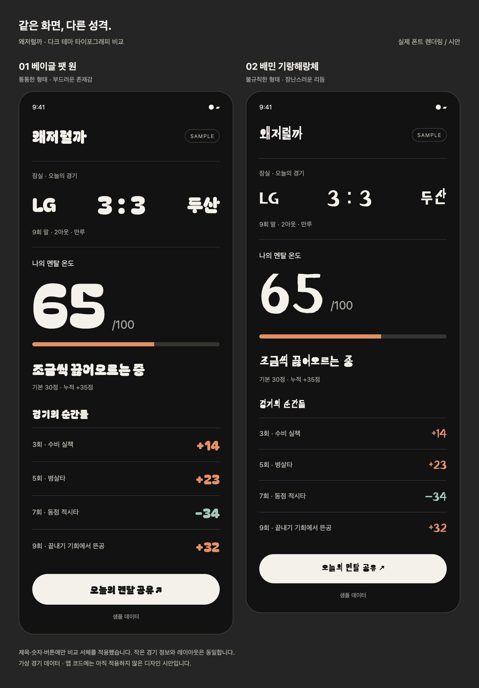

# 디자인 명세

2026-10-29 갱신. **확정 방향은 구장 이미지 중심의 다크 테마와 Bagel Fat One 타이포그래피다.**
기존 종이색·그린 테마를 대체한다. 이 문서는 목표 디자인이며, 현재 앱 코드와 APK에는 아직 이전 테마가 적용돼 있다.

## 승인된 화면 방향

위 이미지는 레이아웃·분위기를 승인한 **생성형 콘셉트 시안**이다. 실제 앱 캡처나 실제 잠실 구장의 정확한 재현이 아니다. 이미지 속 서체 역시 정확한 Bagel Fat One 렌더링을 보장하지 않는다. 최종 구현은 아래 서체 명세를 따른다.

- 큰 구장 이미지와 차콜 배경을 화면 전체로 이어 붙인다.
- 이미지 하단의 어두운 그라데이션 위에 구장명·팀·스코어를 배치한다.
- 제목과 큰 숫자는 둥글고 개성 있게, 경기 상황과 타임라인 본문은 읽기 쉽게 표현한다.
- 아이보리 알약형 버튼을 주요 행동에 사용한다.
- 정보 구획은 여백과 얇은 구분선을 사용하고 카드의 반복을 줄인다.
- 홈과 경기 상세의 공간 구성은 위 시안을 따른다. 아래 서체 비교 화면은 레이아웃 기준이 아니다.

## 타이포그래피

**Bagel Fat One(베이글 팻 원)을 선택한다.** 아래 실제 폰트 비교 이미지의 왼쪽 1번이다. 오른쪽 Kirang Haerang은 채택하지 않는다.

| 용도 | 명세 |
|---|---|
| 서비스 워드마크·주요 제목 | Bagel Fat One Regular |
| 스코어·멘탈 지수 큰 숫자 | Bagel Fat One Regular |
| 강조 문구·주요 버튼 | Bagel Fat One, 긴 문구는 줄바꿈과 가독성 검증 |
| 경기 시각·이닝·아웃·주자·선수·이벤트 본문 | 읽기 쉬운 시스템 고딕체 |
| 보조 설명·상태·오류 문구 | 시스템 고딕체, 충분한 대비와 크기 확보 |

Bagel은 앱에 번들로 포함하고 OFL 라이선스 파일을 함께 보관한다. 작은 정보까지 장식 서체로 통일하지 않는다. 글자 확대 시 제목·팀명·버튼이 잘리지 않도록 검증한다.

## 색상과 공통 컴포넌트

다크 배경·아이보리 전경·주황 스트레스·민트 회복이라는 역할은 확정이다. 정확한 색상 코드와 크기는 구현 시 대비·실기기 검증 후 `src/theme.ts`에 확정한다.

| 역할 | 규칙 |
|---|---|
| 배경 | 차콜·블랙 계열, 구장 이미지와 자연스럽게 연결 |
| 주요 텍스트·CTA | 아이보리, CTA 위 텍스트는 어두운 색 |
| 보조 텍스트·구분선 | 회색 계열, 다크 배경에서 판독 가능한 대비 |
| 스트레스 증가 | 주황 + 양수 부호 + 이벤트 설명 |
| 스트레스 회복 | 민트 + 음수 부호 + 이벤트 설명 |
| 팀 포인트 | 응원팀 색상을 이미지 그라데이션·팀 라벨·선택 탭 등에 제한 적용 |

팀 색상이 스트레스·회복의 의미 색상을 덮어쓰지 않는다. 색상만으로 상태를 구분하지 않으며 숫자·문구·선택 표시를 병행한다. 버튼 최소 높이 50pt를 유지하고 눌림·비활성·로딩 상태를 구분한다.

## 구장·응원석·팀 색상 선택

경기의 **실제 개최 구장**과 사용자의 **응원팀**을 기준으로 이미지를 선택한다. 팀의 기본 홈구장을 그대로 사용하는 방식은 채택하지 않는다.

1. 경기 데이터의 `venueId`, `homeTeamId`, `awayTeamId`로 실제 개최 구장과 대진을 확인한다.
2. 응원팀이 해당 경기의 홈팀인지 원정팀인지 확인한다.
3. 검증된 구장별 응원석 매핑으로 1루·3루 시점을 선택한다. 홈팀은 항상 1루라는 규칙을 두지 않는다.
4. `구장 ID + 응원석 시점`에 해당하는 이미지를 선택하고, 응원팀 색상으로 라벨·선택 상태·그라데이션을 조정한다.

| 경우 | 처리 |
|---|---|
| 같은 구장, 다른 응원팀 | 검증된 응원석 매핑에 따라 시점을 변경 |
| 같은 응원팀, 다른 개최 구장 | 실제 개최 구장의 형태·이미지로 변경 |
| 공동 홈구장·대체 구장·중립 경기 | 실제 경기의 홈/원정 지정과 확인된 예외 매핑 사용 |
| 응원팀이 출전하지 않는 경기·응원팀 미설정 | 중립 시점과 공통 테마 사용 |
| 구장 또는 응원석 정보 미확인 | 중립 이미지 사용, 1루·3루를 추정해 표시하지 않음 |
| 해당 시점 이미지 없음·이미지 로딩 실패 | 구장 중립 이미지, 없으면 공통 일러스트로 대체 |

이미지 자산에는 구장 ID, 시점, 출처, 사용 권한, 검증일을 기록한다. 좌우 반전으로 반대 응원석 시점을 대신하지 않는다. 생성 이미지를 실제 구장 사진으로 표기하지 않는다. 구장별 매핑과 배포용 이미지 확보는 아직 미완료다.

## 화면별 적용

| 화면 | 목표 구성 |
|---|---|
| 오늘의 경기 | 구장 히어로 이미지, 응원팀 경기 강조, 큰 스코어, 이닝·아웃·주자, 기록 진입 버튼 |
| 경기 상세 | 구장 이미지, 큰 멘탈 지수, 상태 문구·게이지, 구분선 타임라인, 결과 공유 버튼 |
| 경기 기록·결과 | 같은 타이포·색상 체계로 경기별 변화와 결과 표시. 상세 레이아웃은 추가 정의 |
| 시즌·선수 통계 | 스트레스 증가·회복·순변화를 구분하고 같은 의미 색상 유지. 상세 레이아웃은 추가 정의 |
| 설정·알림 | 응원팀·리마인드 설정과 권한 상태를 시스템 본문체 중심으로 표시 |

경기 전·진행 중·종료·취소/우천·데이터 지연·수집 실패 상태를 구분한다. 수집 시각을 표시하고 수집 실패를 이벤트 없음으로 표현하지 않는다. 시안의 숫자·팀·문구는 샘플이며 기능 범위를 줄이거나 실제 경기 결과를 뜻하지 않는다.

## 구현 현황

| 항목 | 상태 |
|---|---|
| 다크 테마·구장 중심 레이아웃 | 명세·콘셉트 시안 반영, 앱 미적용 |
| Bagel Fat One | 선택 및 실제 서체 비교 완료, 앱 미적용 |
| 구장·응원석 시점·팀 색상 | 선택 규칙 정의, 매핑·배포 자산·앱 구현 미완료 |
| 기존 종이색 테마 | 현재 앱 코드와 기존 APK에 적용된 이전 프로토타입 |
| 최신 디자인 실기기 캡처 | 미생성 |

구현 시 공통 토큰은 `src/theme.ts`, 공통 컴포넌트는 `src/ui.tsx`에서 관리한다.

## 이전 프로토타입 캡처

아래는 **구버전 구현 화면**이다. 최신 디자인 시안으로 사용하지 않는다. 모바일 크기의 웹 렌더링이며 네이티브 캡처가 아니다.

| 경기 목록 | 경기 상세 | 알림 |
|---|---|---|
|  |  |  |

## 출시 이미지

최신 디자인 구현 후 iOS·Android 실제 화면을 다시 캡처한다. 홈 → 경기 중 멘탈 변화 → 경기 결과 → 시즌 통계를 주요 장면으로 삼되, 출시 시점에 동작하는 기능만 포함한다. 위 생성 시안과 서체 비교 이미지는 스토어 스크린샷으로 제출하지 않는다.

## 참고

- [CREME 디자인 레퍼런스](https://mobbin.com/apps/creme-ios-2437b570-6f06-4b2a-a683-834d6a6ee2de): 시각적 방향 참고용이며 자산 복제 대상이 아니다.
- [Bagel Fat One 소스와 OFL](https://github.com/google/fonts/tree/main/ofl/bagelfatone)
